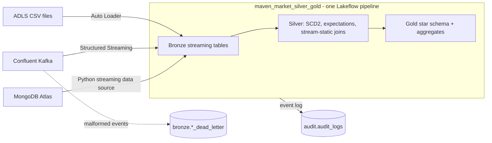

# Maven Market — Secure Retail Analytics Lakehouse

End-to-end, config-driven, governed Databricks lakehouse on Azure. **One Lakeflow Declarative Pipeline owns
the whole flow from source to Gold**: batch CSV (Auto Loader), streaming Confluent Kafka and NoSQL MongoDB
Atlas feed Bronze streaming tables, which feed Silver (cleansing, expectations, SCD2, stream-static joins) and
a Gold star schema. Unity Catalog ABAC (governed tags, one tag-driven column mask, a regional row filter, a
structural rule for Gold) secures it; Databricks Asset Bundles and GitHub Actions ship it.

Capstone for the Rising Star Batch 9 program — evaluation Oct 15–16, 2026.

## The pipeline



| Source | Bronze table(s) | Mechanism | Semantics |
|---|---|---|---|
| CSV (stores, regions, returns, calendar, transactions) | `bronze.<name>` | Auto Loader, `rescue` schema evolution | incremental per file; drift lands in `_rescued_data` |
| Kafka (orders, inventory) | `bronze.orders`, `bronze.inventory` | `readStream` kafka, SASL_SSL | incremental by offset; bad events go to `bronze.<topic>_dead_letter` |
| MongoDB (customers, products) | `bronze.customers`, `bronze.products` | Python streaming data source (`ingestion/mongo_source.py`) | **snapshot-on-change**: nothing is appended while the collection is unchanged; any change appends a fresh snapshot and Silver's SCD2 turns real differences into history. Not CDC: deletes are not detected |

The pipeline is the **single writer** of every Bronze table, and manages their checkpoints and schema
locations. Silver `dim_customer` and `dim_product` are SCD Type 2 (`create_auto_cdc_flow`).

## Layout

| Path | Purpose |
|------|---------|
| `databricks.yml` | DAB root — bundle, variables, dev/prod targets |
| `config/` | Environment + per-source config and data-quality expectations (zero hardcoding) |
| `src/maven_market/pipelines/` | The pipeline: `bronze.py`, `silver.py`, `gold.py`, plus the SQL in `transforms.py` |
| `src/maven_market/ingestion/` | Auto Loader options, Kafka reader/dead-letter split, Mongo helpers and streaming source |
| `src/maven_market/jobs/` | Job entry points: `governance` (policies, tags, gate), `pipeline_audit` |
| `src/maven_market/producers/` | Kafka event simulator and the MongoDB seed script |
| `src/maven_market/logging_utils.py` | stdlib-`logging` audit trail written to `audit.audit_logs` |
| `resources/` | DAB resources: the pipeline and the jobs |
| `policies/` | Cluster policy JSON |
| `sql/governance/` | Catalog/schema DDL, governed tags, grants, ABAC policies, row filter, structural rule |
| `tests/` | pytest suite (run in CI) |
| `docs/` | POC write-ups; implementation plan |

## Jobs

| Job | What it does |
|---|---|
| `medallion_refresh` | One pipeline update (CSV + Kafka + MongoDB → Bronze → Silver → Gold), then `audit` (records the update in `audit_logs`, also on failure) and `govern` (re-applies tags, fails if a Gold table is untagged) |
| `governance_bootstrap` | First-time setup: create/replace the ABAC policies, apply tags, run the gate |
| `kafka_producer` | Simulate orders + inventory events into Confluent Kafka (keys come from the Bronze dimensions) |

## Local dev

```bash
python -m venv .venv && source .venv/bin/activate
pip install -e ".[dev]"
pytest          # run tests
flake8          # lint
databricks bundle validate -t dev
databricks bundle deploy   -t dev
databricks bundle run medallion_refresh -t dev      # or: bundle run silver_gold [--full-refresh-all]
```

## First-time / seeding notes

- Secrets (Key Vault-backed scope `maven_market`): `confluent-bootstrap`, `confluent-api-key`,
  `confluent-api-secret`, `mongo-uri`.
- Seed Atlas from the source CSVs: `python -m maven_market.producers.mongo_seed` (needs `MONGO_URI`).
- The pipeline's run-as identity must be in the `admin` group, which the ABAC policies exempt; otherwise masked
  or filtered values would be written permanently into the tables it builds.
- If a Bronze/Silver table already exists as a plain managed table or a materialized view with the same name,
  drop it once: a pipeline cannot take over a table it did not create.

Implementation plan: `docs/superpowers/plans/2026-10-11-maven-market-lakehouse.md`.
