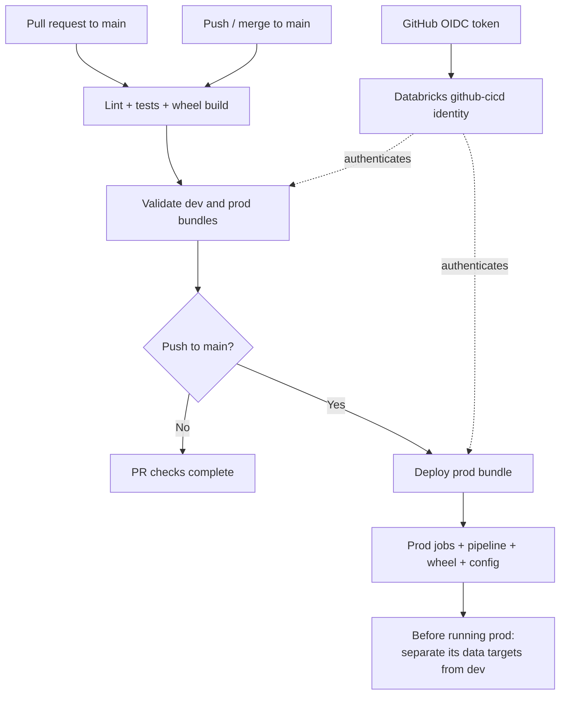

# POC 2 — DABs Implementation and CI/CD

## Bundle assembly and targets

The project was assembled as a Python package with a hand-authored
[databricks.yml](../../databricks.yml). There is no retained `bundle init` transcript; the root
file is the reproducible bundle definition.

| Part | Configuration |
|---|---|
| Identity and includes | Bundle `maven_market`; includes `resources/*.yml` |
| Artifact | `pip wheel --no-deps -w dist .` builds the package defined in [pyproject.toml](../../pyproject.toml) |
| Pipeline | [pipelines.yml](../../resources/pipelines.yml) loads Bronze, Silver and Gold Python files into one serverless pipeline |
| Jobs | [jobs.yml](../../resources/jobs.yml) defines `medallion_refresh`, `governance_bootstrap`, `kafka_producer` |
| Variables | Catalog/schema names, secret scope, environment, producer count/rate; `${var.env}` selects dev/prod config |
| Dev target | Development mode; `/Workspace/Users/akankshalokhande1455@gmail.com/.bundle/maven_market/dev` |
| Prod target | Production mode; `/Workspace/Shared/.bundle/maven_market/prod` |

Both targets currently select the same workspace and catalog. Bundle variables configure the
resources; Python loads [config/defaults.yml](../../config/defaults.yml) plus the environment YAML.
Environment isolation must cover both settings. Dashboards are separate workspace assets.

## Shell verification

Run from the repository root with the existing CLI profile:

```bash
databricks bundle validate -t dev -p ak-dbx
databricks bundle validate -t prod -p ak-dbx
databricks bundle summary -t dev -p ak-dbx
```

Rechecked on 29 October 2026: dev reports `Validation OK!`; prod exits 0 with one warning about
the shared writable root. Existing deployment and run evidence:

| Asset | Dev | Prod |
|---|---|---|
| Medallion job | `589374110218914`; run `754558379498222` succeeded | `295531065482105`; deployed by `github-cicd` |
| Pipeline | `64bd84f5-d0ba-44fa-bb0d-e3a50426c427`; completed update | `c02f61d3-a752-42dd-879e-bf840984b99e`; no run evidence |

The prod job below was deployed by the workflow itself. It is locked to the bundle and has no runs,
which is the expected state after a deploy-only pipeline:


To deploy and execute an intentional dev change:

```bash
databricks bundle deploy -t dev -p ak-dbx
databricks bundle run medallion_refresh -t dev -p ak-dbx
```

These commands update the workspace/data; they were not rerun merely to refresh this document.

## CI/CD



Validation and deployment use the `prod` environment's federated identity. A successful deployment
creates resources; it does not run the prod pipeline.

Workflow: [.github/workflows/deploy.yml](../../.github/workflows/deploy.yml).

| Event | Jobs |
|---|---|
| Pull request to `main` | `test` (flake8 + pytest + wheel build) -> `validate` (`bundle validate` for dev and prod) |
| Push / merge to `main` | `test` -> `validate` -> `deploy-prod` (`bundle deploy -t prod`) |

**Authentication is OIDC workload-identity federation.** GitHub issues a short-lived token for the
run, Databricks exchanges it for an OAuth token for a service principal. No personal access token
and no long-lived Databricks secret is stored anywhere.

The `validate` and `deploy-prod` jobs are skipped until the repository variable `DATABRICKS_HOST`
exists, so the workflow can be merged before the setup below is finished. `test` always runs.

## One-time setup

### 1. Service principal (Databricks account console)

1. `accounts.azuredatabricks.net` -> **User management -> Service principals -> Add service principal**.
2. Name it `github-cicd`. Note its **Application (client) ID** and its numeric **ID** (shown in the URL).
3. **Workspaces** tab of the account console: add the service principal to the `dbw-maven-market`
   workspace (permission **User** is enough to deploy a bundle).

### 2. Federation policy (account-level CLI)

The subject must match the token's `sub` claim **exactly**. GitHub repositories created on or after
2026-07-15 use an immutable format with numeric IDs. This repository's value was read from
`gh api repos/sameedmajgaonkar/maven-market/actions/oidc/customization/sub`:

```
repo:sameedmajgaonkar@120316421/maven-market@1415953781
```

so, for jobs that use the `prod` environment, the full subject is
`repo:sameedmajgaonkar@120316421/maven-market@1415953781:environment:prod`.

```bash
databricks auth login --host https://accounts.azuredatabricks.net --account-id <ACCOUNT_ID>
databricks account service-principal-federation-policy create <SP_NUMERIC_ID> --json '{
  "oidc_policy": {
    "issuer": "https://token.actions.githubusercontent.com",
    "audiences": ["<ACCOUNT_ID>"],
    "subject": "repo:sameedmajgaonkar@120316421/maven-market@1415953781:environment:prod"
  }
}'
```

### 3. Permissions for the service principal

`bundle deploy` writes to `/Workspace/Shared/.bundle/maven_market/prod` and creates jobs and a
pipeline. Grant, as a workspace/metastore admin:

```sql
GRANT USE CATALOG ON CATALOG maven_market_uc TO `<SP_APPLICATION_ID>`;
GRANT USE SCHEMA, CREATE TABLE, SELECT, MODIFY ON SCHEMA maven_market_uc.bronze TO `<SP_APPLICATION_ID>`;
GRANT USE SCHEMA, CREATE TABLE, CREATE MATERIALIZED VIEW ON SCHEMA maven_market_uc.silver TO `<SP_APPLICATION_ID>`;
GRANT USE SCHEMA, CREATE TABLE, CREATE MATERIALIZED VIEW ON SCHEMA maven_market_uc.gold TO `<SP_APPLICATION_ID>`;
GRANT USE SCHEMA, CREATE TABLE, SELECT, MODIFY ON SCHEMA maven_market_uc.audit TO `<SP_APPLICATION_ID>`;
GRANT READ FILES, WRITE FILES ON EXTERNAL LOCATION loc_landing TO `<SP_APPLICATION_ID>`;
GRANT READ FILES, WRITE FILES ON EXTERNAL LOCATION loc_unity_catalog TO `<SP_APPLICATION_ID>`;
```
Runtime also requires secret-scope access, appropriate object permissions, and the `admin` account
group exemption from ABAC. The existing `github-cicd` principal is in that group. These grants do
not establish environment isolation or prove that prod has run successfully.

### 4. GitHub configuration

```bash
gh variable set DATABRICKS_HOST --body "https://adb-7405615136388825.5.azuredatabricks.net"
```
Then in the repo: **Settings -> Environments -> New environment -> `prod`** and add the environment
secret `DATABRICKS_CLIENT_ID` = the service principal's application (client) ID.

Do **not** add required reviewers to `prod` if you want pull-request validation to run
automatically: both `validate` and `deploy-prod` use this environment (their OIDC subject depends on it).

Optional: **Settings -> Branches -> add rule for `main`** requiring the `Lint and unit tests` and
`Validate bundle (dev + prod)` checks, so nothing merges unless CI is green.

## Demonstration for the evaluation

1. Create a branch, change something small, open a pull request.
2. Show the PR checks: lint, tests, validate (dev + prod).
3. Break something deliberately (an unused import) and show flake8 fail the PR; fix it.
4. Merge. Show the push-to-main run: `deploy-prod` deploys the bundle.
5. In the workspace, show the prod jobs/pipeline created by the service principal.

Recorded [Actions run 40743097065](https://github.com/sameedmajgaonkar/maven-market/actions/runs/40743097065)
shows all three jobs successful: lint/tests 18 s, validate 10 s, deploy 19 s; total wall time 55 s.
The screenshot was captured by OpenCode and visually rechecked. A fresh GitHub CLI request was
blocked by network access during the continuation.


## Known limitation

`dev` and `prod` share one workspace and one catalog here, so a **prod pipeline would write the same
Bronze, Silver and Gold tables as the dev pipeline**; Unity Catalog allows only one pipeline to own a
table. Prod resources were deployed, but its pipeline must have separate targets before execution. A real
setup would use a separate workspace or catalog per environment, updating both bundle variables
and runtime configuration. Prod also warns that its `/Workspace/Shared` root is writable by all
workspace users. Neither limitation is resolved by a successful validation or deployment.
